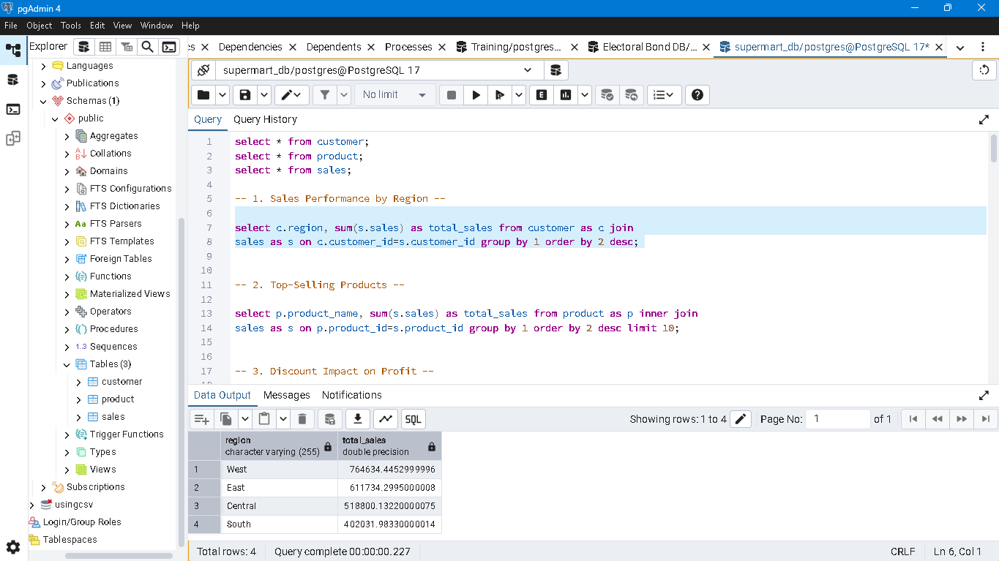
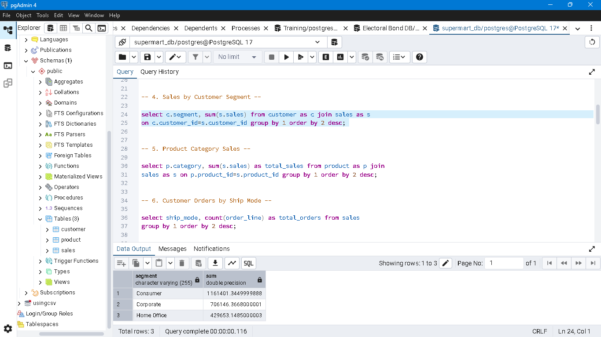
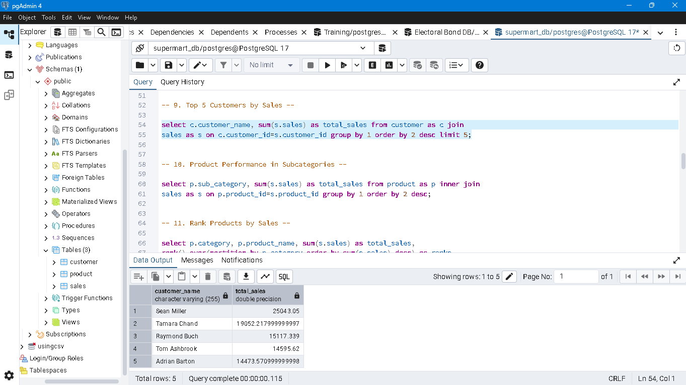
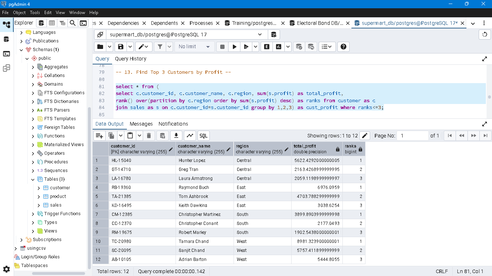

# Supermart_DB_Project

## Project Overview
This project analyzes the Supermart database using PostgreSQL to identify sales trends, customer behavior, product performance, and profitability. The analysis was performed locally using pgAdmin.

## Objectives
- Analyze sales performance across regions and customer segments.
- Identify top-selling products and product categories.
- Understand the impact of discounts on profit.
- Identify top customers based on sales and profit.
- Analyze monthly sales and customer distribution.
- Practice SQL joins, aggregate functions, window functions, and ranking techniques.

## Tools & Technologies
- **Database:** PostgreSQL
- **SQL Environment:** pgAdmin
- **Dataset:** Supermart Database (`supertmart_DB`)

## Project Preview










## Key Analysis
The project covers 20 SQL analysis tasks, including:

1. Sales performance by region.
2. Top-selling products.
3. Discount impact on profit.
4. Sales by customer segment.
5. Sales by product category and subcategory.
6. Orders by shipping mode.
7. Monthly sales trends.
8. Customer distribution by state.
9. Top 5 customers by sales.
10. Product ranking within categories.
11. Cumulative sales and running profit totals.
12. Top 3 customers by profit within each region.
13. Average sales by segment and customer ranking.
14. Sales differences using `LAG()`.
15. Regional contribution to total sales.
16. Moving averages of sales.
17. Largest and smallest sales amounts by customer.
18. Dense ranking of sales by shipping mode.

## SQL Concepts Used
- `SELECT`, `WHERE`, `GROUP BY`, `ORDER BY`
- Aggregate functions: `SUM()`, `AVG()`, `MAX()`, `MIN()`, `COUNT()`
- Joins using `INNER JOIN`
- Window functions: `RANK()`, `DENSE_RANK()`, `ROW_NUMBER()`
- Analytical functions: `LAG()`
- Running totals and moving averages
- Percentage calculations

## Project Structure

```text
Supermart_DB_Project/
│
├── README.md
└── Questions_Supermart_DB.pdf
└── SQL_MIni_Project.sql
└── Screenshots
```


## How to Run the Project
1. Download the Supermart database.
2. Open pgAdmin and create or select the appropriate database.
3. Import or restore the database using the provided database file.
4. Open the SQL query file in pgAdmin's Query Tool.
5. Execute the queries to perform the analysis.

## Key Learnings
- Writing SQL queries to analyze business data.
- Combining multiple tables using joins.
- Summarizing sales and profit using aggregate functions.
- Applying window functions to rank records and calculate running totals.
- Extracting business insights from sales data.

## Author
**Rashid Kamal**

